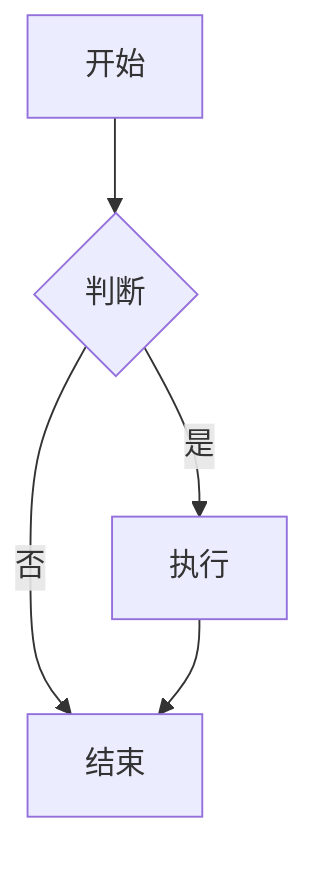

# DSH Markdown Live Preview 测试文档

## 功能测试清单

### 1. 基础渲染
- **粗体** 和 *斜体*
- ~~删除线~~
- `行内代码`
- [链接示例](https://example.com)

### 2. 代码块

```typescript
function greet(name: string): string {
  return `Hello, ${name}!`;
}

console.log(greet('DSH'));
```

```python
def fibonacci(n):
    if n <= 1:
        return n
    return fibonacci(n-1) + fibonacci(n-2)

print([fibonacci(i) for i in range(10)])
```

### 3. 列表

- 无序列表项 1
- 无序列表项 2
  - 嵌套项
  - 嵌套项

1. 有序列表项 1
2. 有序列表项 2
3. 有序列表项 3

### 4. 表格

| 功能 | 状态 | 说明 |
|------|------|------|
| 实时预览 | ✅ | 编辑时自动渲染 |
| 文件热更新 | ✅ | 文件变化自动刷新 |
| 目录导航 | ✅ | 点击 TOC 跳转 |
| 选区发送 | ✅ | 选中发送到对话 |

### 5. 引用

> 这是一段引用文本
> 可以有多行

### 6. 任务列表

- [x] 已完成任务
- [ ] 待完成任务
- [ ] 另一个待办

### 7. 分割线

---

### 8. 图片


## 多级标题测试

### 三级标题

#### 四级标题

##### 五级标题

###### 六级标题

## 数学公式（如果支持）

行内公式：$E = mc^2$

块级公式：

$$
\int_{-\infty}^{\infty} e^{-x^2} dx = \sqrt{\pi}
$$

## Mermaid 图表（如果支持）



---

**测试说明**：
1. 在 DSH 中打开此文件
2. 尝试编辑模式（点击 ✏️）
3. 修改内容，观察右侧是否实时预览
4. 在外部编辑器修改此文件，观察是否自动刷新
5. 在预览模式下选中文本，观察是否发送到对话
