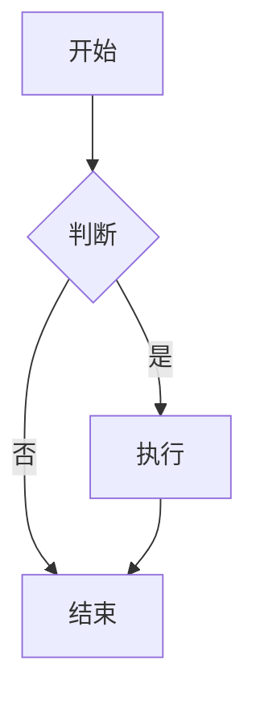

# DSH Markdown Live Preview 测试文档

## 功能测试清单

### 1. 基础渲染
- **粗体** 和 *斜体*
- ~~删除线~~
- `行内代码`
- [链接示例](https://example.com)

### 2. 代码块

```typescript
function greet(name: string): string {
  return `Hello, ${name}!`;
}

console.log(greet('DSH'));
```

```python
def fibonacci(n):
    if n <= 1:
        return n
    return fibonacci(n-1) + fibonacci(n-2)

print([fibonacci(i) for i in range(10)])
```

```bash
# 这一行故意写得很长，用来检查横向滚动以及复制按钮是否还在可视范围内
curl -sSL https://raw.githubusercontent.com/lg114/dsh-md-live/main/scripts/verify-client.cjs | head -20
```

### 3. 列表

- 无序列表项 1
- 无序列表项 2
  - 嵌套项
  - 嵌套项

1. 有序列表项 1
2. 有序列表项 2
3. 有序列表项 3

### 4. 表格

| 功能 | 状态 | 说明 |
|------|------|------|
| 实时预览 | ✅ | 编辑时自动渲染 |
| 文件热更新 | ✅ | 文件变化自动刷新 |
| 目录导航 | ✅ | 点击 TOC 跳转 |
| 选区发送 | ✅ | 选中发送到对话 |

### 5. 引用

> 这是一段引用文本
> 可以有多行

### 6. 任务列表

- [x] 已完成任务
- [ ] 待完成任务
- [ ] 另一个待办

### 7. 分割线

---

### 8. 图片

本地图片（相对路径，经 Host 的 `api/file` 端点提供 —— 这是以前会显示成破图的那类）：


带 `..` 的相对路径（应当解析到同一张图）：


远程图片（需要联网，且不应被改写地址）：


### 9. 链接

- 指向同仓库另一篇文档：[README](./README.md)（应当在当前 tab 打开，而不是把整个应用导航走）
- 页内锚点：[跳到「表格」](#4-表格)（应当原地滚动）
- 外部链接：[DeepSeek](https://www.deepseek.com)（应当交给系统浏览器）
- 指向非 Markdown 文件：[package.json](./package.json)（应当交给系统默认应用打开）

## 多级标题测试

### 三级标题

#### 四级标题

##### 五级标题

###### 六级标题

## 数学公式（如果支持）

行内公式：$E = mc^2$

块级公式：

$$
\int_{-\infty}^{\infty} e^{-x^2} dx = \sqrt{\pi}
$$

## Mermaid 图表（如果支持）



---

**验证清单**：

1. 顶部折叠框显示 `frontmatter · 4 行`，展开能看到 YAML；正文第一行应该是大标题而不是一条分隔线
2. 代码块悬停时右上角出现语言名和「复制」；复制后按钮变「已复制」
3. 第 8 节两张本地图都能显示，第 3 张远程图需要联网
4. 第 9 节：点 `README` 在当前 tab 打开、点外部链接走浏览器、点锚点原地滚动
5. 目录跟随滚动高亮当前章节，点折叠按钮收成窄栏
6. 头部 `Aa` 打开阅读设置，调字号/行距/行宽后重开面板仍然生效
7. 头部两个图标：用系统默认应用打开、在文件管理器中显示
8. 用外部编辑器改这个文件，面板应当自动刷新（不需要手动刷新按钮）
